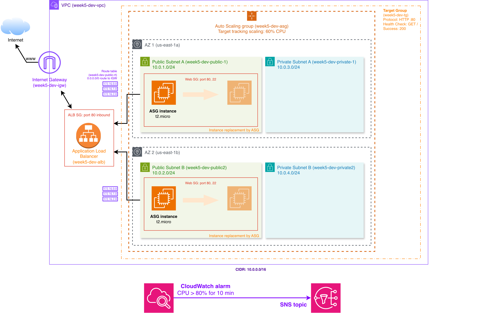

# Week 5 — Terraform Fundamentals + Modules (Autoscaling Web Tier)

> **What this proves:** Can codify a multi-AZ web tier in Terraform with modules, keep dev and prod in separate state, and deploy or destroy each one with one command.

Weeks 2-3 proved I could build a VPC and a high-availability web tier by hand. This week I rebuilt the same architecture (ALB, Auto Scaling Group, a CloudWatch alarm) in Terraform, with two modules and separate dev and prod environments. Each environment is its own directory with its own state. One `terraform apply` in `envs/dev` creates dev. One `terraform destroy` there tears it down, and prod is never touched.

## Quick demo (video)

LinkedIn article + video: [Terraform deployed my entire AWS architecture in under 5 minutes. Here is why I stopped clicking the Console.](https://www.linkedin.com/pulse/terraform-deployed-my-entire-aws-architecture-under-5-fresco-glife/)

---

**ALB → Target Group → ASG (2 AZs) + CloudWatch alarm → SNS**



---

## Output

- Architecture diagram: [`infra/week5-architecture.png`](./infra/week5-architecture.png)
- Decision log: [`docs/DECISIONS.md`](./docs/DECISIONS.md)
- Terraform source: [`envs/`](./envs/) (one root per environment), [`modules/`](./modules/)

---

## What I built

| Category | Resource | Details |
| --- | --- | --- |
| Networking | VPC | 2 public + 2 private subnets across multiple AZs |
| Networking | Internet Gateway | Public route table with 0.0.0.0/0 route |
| Compute | Launch Template | Amazon Linux 2023, Apache httpd via user data |
| Compute | Auto Scaling Group | Min/max/desired configurable per environment |
| Compute | Scaling Policy | Target tracking at 60% average CPU |
| Load Balancing | Application Load Balancer | HTTP listener on port 80 |
| Load Balancing | Target Group | Health checks on instance port |
| Security | ALB security group | HTTP inbound from anywhere |
| Security | Web instance security group | HTTP inbound from ALB only (no SSH) |
| Monitoring | CloudWatch alarm | CPU > 80% sustained for 10 min |
| Monitoring | SNS topic | Alert notifications |

### Module responsibilities

**`modules/vpc`** — Owns all networking. Creates the VPC, IGW, subnets distributed across dynamically discovered AZs, and the public route table. Private subnets intentionally have no NAT Gateway (cost optimization).

**`modules/web-tier`** — Owns everything on top of the VPC: security groups, ALB, target group, listener, launch template, ASG, scaling policy, SNS topic and CPU alarm. The ALB SG accepts HTTP from the internet; the web SG only accepts HTTP from the ALB SG (source-SG reference, not CIDR), so instance public IPs cannot be hit directly.

**`envs/dev`, `envs/prod`** — One Terraform root per environment. Each one calls both modules with that environment's values and keeps its own state file, so a `terraform apply` in `envs/dev` cannot change prod. See decision 1 in [`docs/DECISIONS.md`](./docs/DECISIONS.md) for why I chose directories over workspaces.

---

## What I tested

- Running `terraform plan` to verify the dependency graph resolves correctly before any resources exist
- Watching the ASG replace an instance after ELB health checks failed
- Running `terraform destroy` and verifying zero resources remain (no orphaned ENIs, no dangling SGs)

---

## Prerequisites

| Requirement | Version |
| --- | --- |
| [Terraform](https://developer.hashicorp.com/terraform/install) | >= 1.5.0 |
| [AWS CLI](https://docs.aws.amazon.com/cli/latest/userguide/install-cliv2.html) | v2+ |
| AWS credentials configured | `aws configure` or env vars |
| AWS account with EC2/VPC/ELB permissions | — |

---

## Quick Start

```bash
# 1. Clone the repo
git clone https://github.com/sebasfresco/aws-cloud-engineering-portfolio.git
cd aws-cloud-engineering-portfolio/week-05-terraform-fundamentals-modules/envs/dev

# 2. Initialize Terraform (downloads the AWS provider pinned in .terraform.lock.hcl)
terraform init

# 3. Preview, then deploy dev
terraform plan
terraform apply

# 4. Verify the web server is running (may take ~2 min for instances to pass health checks)
curl http://$(terraform output -raw alb_dns_name)

# 5. Tear down when done
terraform destroy
```

Prod works the same way from `envs/prod`. The environment values are in each `main.tf`, so there are no tfvars files to create.

---

## Project Structure

```text
week-05-terraform-fundamentals-modules/
├── envs/
│   ├── dev/
│   │   ├── main.tf                  # Backend, provider, dev values for both modules
│   │   ├── variables.tf             # Region
│   │   ├── outputs.tf               # VPC ID, ALB DNS name, ASG name
│   │   └── .terraform.lock.hcl      # Provider versions, committed
│   └── prod/                        # Same files, prod values, separate state
├── modules/
│   ├── vpc/
│   │   ├── main.tf                  # VPC, IGW, subnets, route tables, associations
│   │   ├── variables.tf             # name, vpc_cidr, public/private subnet CIDRs
│   │   └── outputs.tf               # vpc_id, public_subnet_ids, private_subnet_ids, vpc_cidr_block
│   └── web-tier/
│       ├── main.tf                  # SGs, ALB, target group, listener, launch template, ASG, scaling, alarm
│       ├── variables.tf             # Sizing, instance type, ports, thresholds
│       └── outputs.tf               # alb_dns_name, asg_name
├── docs/
│   └── DECISIONS.md                 # Architecture decisions
└── infra/
    └── week5-architecture.png       # Architecture diagram
```

---

## Environment Comparison

| Setting | Dev | Prod |
| --- | --- | --- |
| Directory | `envs/dev` | `envs/prod` |
| State file | `envs/dev/terraform.tfstate` | `envs/prod/terraform.tfstate` |
| Name prefix | `week5-dev` | `week5-prod` |
| Region | `us-east-1` | `us-east-1` |
| VPC CIDR | `10.0.0.0/16` | `10.1.0.0/16` |
| Public subnets | `10.0.1.0/24`, `10.0.2.0/24` | `10.1.1.0/24`, `10.1.2.0/24` |
| Private subnets | `10.0.3.0/24`, `10.0.4.0/24` | `10.1.3.0/24`, `10.1.4.0/24` |
| Instance type | `t3.micro` | `t3.medium` |
| ASG min / max / desired | 1 / 2 / 1 | 2 / 6 / 2 |

> Dev and prod have separate state, different name prefixes and different VPC CIDRs (`10.0.x.x` vs `10.1.x.x`), so both can run in the same AWS account at the same time without touching each other.

---

## Outputs

After `terraform apply`, the following values are available:

| Output | Description |
| --- | --- |
| `vpc_id` | ID of the created VPC |
| `alb_dns_name` | ALB DNS name — visit `http://<this>` to test |
| `asg_name` | Auto Scaling Group name |

---

## Cost reality (us-east-1, dev)

| Resource | Est. Monthly Cost |
| --- | --- |
| ALB ($0.0225/hr) | ~$16.43 + LCU charges |
| EC2 t3.micro x 1 ($0.0104/hr) | ~$7.59 |
| Public IPv4 addresses x 3 (2 on the ALB, 1 on the instance, $0.005/hr each) | ~$10.95 |
| VPC, subnets, IGW, route tables | $0 |
| CloudWatch alarm (1 metric) | ~$0.10 |
| SNS topic + email | $0 at this volume |
| **Dev total** | **~$35/month + LCU** |
| NAT Gateway (not included) | ~$32/month if added |

> The ALB and its public IPv4 addresses are the main cost drivers. Every extra instance adds about $7.59 plus $3.65 for its public IP. New AWS accounts get sign-up credits rather than the old 12-month free tier, so this estimate does not assume free EC2 hours. Tear down dev environments when not in use.

---

## Design rationale

1. **Terraform's dependency graph resolves ordering from references.** A subnet referencing `aws_vpc.main.id` tells Terraform the VPC must exist first. File position is irrelevant.
2. **ELB health checks catch what EC2 checks miss.** An instance can be "running" at the hypervisor level while the application process has crashed. `health_check_type = "ELB"` verifies the app actually responds.
3. **Separate security groups per tier enforce least privilege.** The ALB accepts public traffic, but instances only accept traffic from the ALB. A shared SG would expose instances directly to the internet.
4. **Non-overlapping VPC CIDRs between environments enable future peering.** If dev and prod both used `10.0.0.0/16`, you could never connect them or route between them unambiguously.
5. **Modules remove duplication; `plan` catches drift.** One module serves every environment. Change it once, and each environment picks up the change on its next `terraform apply` instead of me editing N copies. Modules do not stop drift. Someone can still change a resource in the Console. `terraform plan` is what detects it.

---

## Production Improvements

Changes needed before running real workloads:

- **NAT Gateway** — lets private-subnet instances reach the internet for package updates without being publicly exposed (~$32/month).
- **HTTPS (ACM + ALB listener rule)** — encrypts traffic in transit; required for any user-facing service. Terminate TLS at the ALB with a free ACM certificate.
- **Private subnets for instances** — move ASG instances out of public subnets so they have no public IPs. All traffic should flow exclusively through the ALB.
- **Remote state (S3 with native locking)** — local `.tfstate` files cannot be shared or locked. Teams need a shared backend with state locking to prevent concurrent writes. The S3 backend now locks with `use_lockfile = true`; DynamoDB-based locking is deprecated. Each env's `main.tf` has a commented example with a separate key per environment.
- **WAF** — attach AWS WAF to the ALB to protect against OWASP top 10 attacks (SQLi, XSS, bot traffic).
- **Ops access** — no SSH is configured. For shell access in production, use SSM Session Manager (no SSH port required) or add a bastion host in a public subnet.
